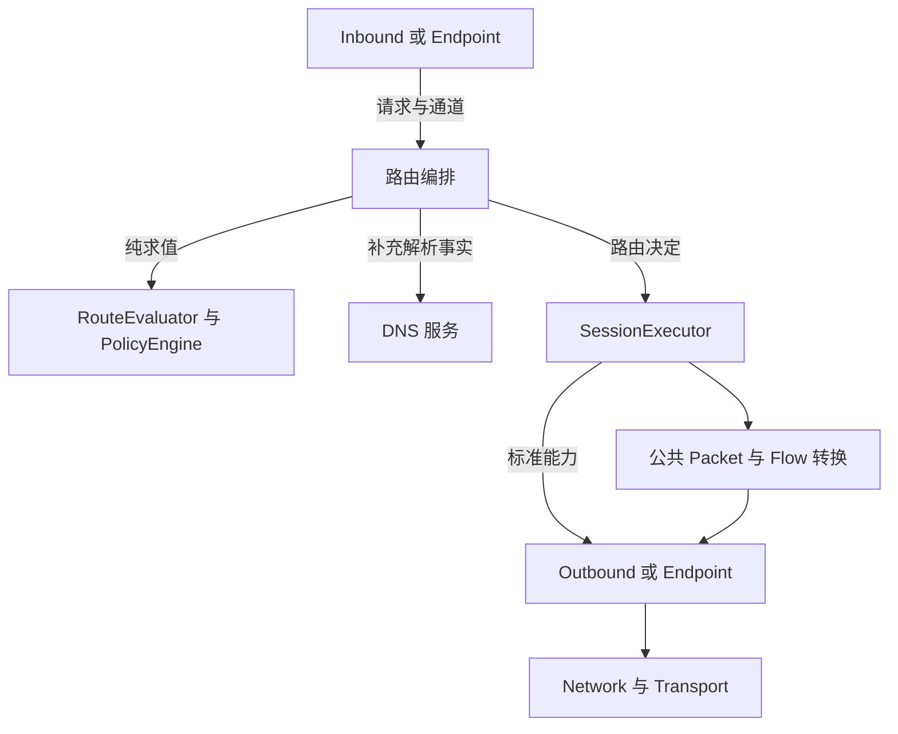
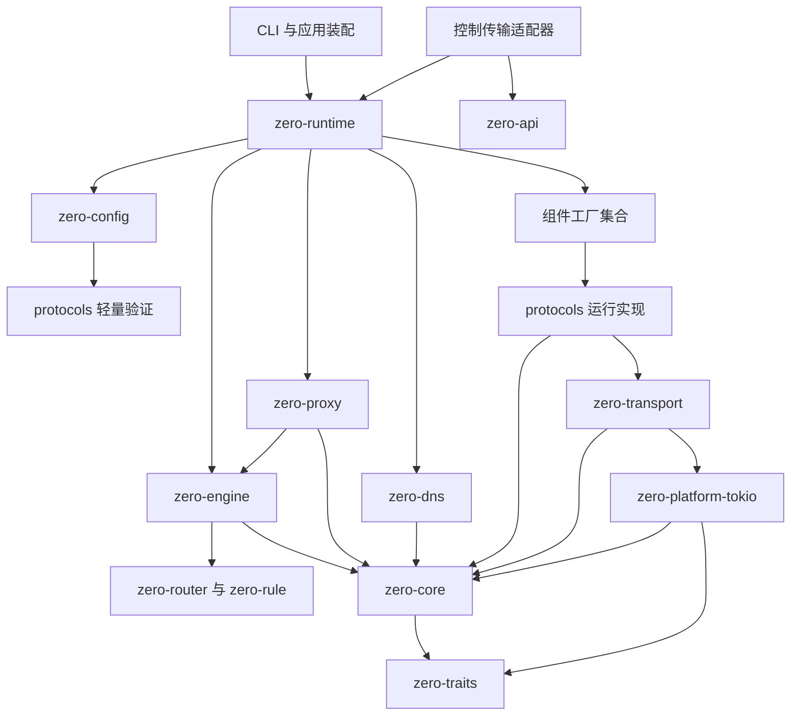

# 架构与组件职责

本文件保存目标架构、当前观察和已确认决策；当前源码事实仍以登记的基线核对。

[方案入口](README.md) · [架构](architecture.md) · [契约](contracts.md) · [迁移与任务卡](migration.md) · [兼容](compatibility.md) · [验证](validation.md) · [来源](references.md)

<!-- source-section: 02 -->
# 设计依据与当前问题

## 参考基线

Zero 源码基线为 `f0c1cc0930df8c34f1822cdd182928511e319b76`，设计日期为 2026 年 10 月 16 日。客户端与面板采用本次读取的本地源码作为集成参考，不代表已部署版本。

sing-box 参考固定为 `dfb80349bf5779ec0a3f834c9ec2794345bff8f0`。该提交是架构观察基线，不改变 Zero 各协议已经选定的上游实现版本和互通基线。

sing-box 的 Box 装配网络、DNS、路由、连接、入站、出站及端点管理组件；Outbound 直接提供拨号行为，注册表登记配置构造和实例构造，生命周期通过分阶段启动与 Scope 管理资源。[Box 装配](https://github.com/SagerNet/sing-box/blob/dfb80349bf5779ec0a3f834c9ec2794345bff8f0/box.go)、[Outbound](https://github.com/SagerNet/sing-box/blob/dfb80349bf5779ec0a3f834c9ec2794345bff8f0/adapter/outbound.go)、[Registry](https://github.com/SagerNet/sing-box/blob/dfb80349bf5779ec0a3f834c9ec2794345bff8f0/adapter/outbound/registry.go)、[Lifecycle](https://github.com/SagerNet/sing-box/blob/dfb80349bf5779ec0a3f834c9ec2794345bff8f0/adapter/lifecycle.go)。

Zero 借鉴组件分工、公共设施复用与顶层装配。Rust 侧采用显式依赖注入和明确的所有权，不把服务定位式 context 变成任意访问内核的入口。sing-box 的 PacketConn 通道与 Zero 的完整 IP Packet 通道必须区分，不能把 UDP 数据报和 L3 报文混为一个类型。

本轮另核对 Xray 参考提交 92ccc939aaf4f8965f369cf0b142e005aeaa11d5 的 [Process 协议入口](https://github.com/XTLS/Xray-core/blob/92ccc939aaf4f8965f369cf0b142e005aeaa11d5/proxy/proxy.go#L61) 与 [SOCKS 会话执行](https://github.com/XTLS/Xray-core/blob/92ccc939aaf4f8965f369cf0b142e005aeaa11d5/proxy/socks/client.go)。Zero 选择更接近 sing-box 的标准通道交付边界，并采用 Rust 具体类型、关联类型、所有权和集中的异构擦除；不直接照搬 Go 的服务定位器或完整 Process 会话接管方式。两个项目的观察提交不替换各协议已经固定的上游实现基线。

## 当前需要解决的问题

| 当前代码事实 | 设计影响 |
| --- | --- |
| proxy 的 capability、claimed leaf、prepared operation 和 transport leaf 多次表达同一连接行为 | 接入者必须理解多组执行包装 |
| registry 引用 runtime 操作，runtime 又引用 registry 执行服务 | 模块名称不能直接解释职责和依赖 |
| UDP resume 用 Any 保存，再由 handler 识别和恢复具体类型 | 类型关联在正常数据路径上转为运行时判断 |
| config 编译路由并加载资源，engine 持久化与切换配置，proxy 和 application 再协调运行资源 | 配置更新缺少单一的事务责任边界 |
| traits 中同时包含基础 I/O、transport 配置和管理流程辅助类型 | 最底层契约逐渐承接上层实现细节 |

对应源码见 [capability](../../crates/proxy/src/protocol_registry/capability.rs)、[UDP resume](../../crates/proxy/src/runtime/udp_flow/managed/flow/resume.rs)、[配置编译](../../crates/config/src/compile.rs)、[Engine 配置管理](../../crates/engine/src/runtime/configuration.rs)。

已有 Packet 路由、NetworkGraph 和公共 Flow 转换保留其有效语义。不能把重新实现这些能力当作完成整体分层。
<!-- /source-section: 02 -->

<!-- source-section: 03 -->
# 目标组件与职责

逻辑服务不等同于独立 crate。先定义唯一职责与契约，再安排代码位置。

| 组件 | 唯一责任 | 不承担 |
| --- | --- | --- |
| RuntimeHost 运行宿主 | 组件装配、生命周期依赖、配置事务、运行代际和整体停止 | 协议解析、逐包转发 |
| Configuration 配置 | 外部配置解码、结构及引用检查、委托协议验证 | 启动设备、打开监听、运行策略 |
| PolicyEngine 策略状态 | 模式、准入、主体限制、组选择、会话身份和运行事实 | socket I/O、配置文件持久化 |
| RouteEvaluator 路由求值 | 根据规则和事实得出决定或请求补充事实 | DNS 查询、实例构建 |
| SessionExecutor 会话执行 | 调用路由与出站、数据转发、背压、限速执行和取消 | 协议编码、密码和复用状态 |
| Inbound 接入组件 | 接入载体、握手、认证、交付标准请求和客户端响应 | 业务路由与全局配额决策 |
| Outbound 出站组件 | 按目标建立标准通道、管理协议内部复用 | 改写既定路由、直接操作内核注册表 |
| Endpoint 端点组件 | 共享设备或连接资源、按需提供接入与出站角色 | 被强制拆成两套独立设备状态 |
| DNS 服务 | 查询策略、缓存、fake-IP、上游查询 | 绕过网络策略自行出网 |
| Network 服务 | 拨号、绑定、物理出口、网络变化与拨号约束 | 协议握手、业务规则 |
| Transport 与 Stack | 通用载体、协议无关的 IP 与流转换 | 具体业务目标选择、控制面流程 |
| Observation 与 Control | 事实聚合、查询命令、版本化对外投影 | 通过外部 DTO 定义内部状态机 |

策略层决定限额与准入；执行层实施 I/O 限速与取消。健康状态由领域层保存，探测通过标准执行入口产生事实。注册表只保存类型和构造能力；实例管理器维护实例、依赖与存续，两者均不执行协议握手。

## 数据路径

这张图表示运行协作，不表示 Rust 源码依赖。RuntimeHost 在数据路径之外创建、更新与关闭组件。观测在标准边界采集事实，控制入口向宿主和领域服务发出命令。
<!-- /source-section: 03 -->

<!-- source-section: 04 -->
# crate 归属与依赖规则

| 位置 | 目标归属 | 迁移要求 |
| --- | --- | --- |
| zero-traits | no_std 的纯类型、缓冲与必要的中立契约 | 移出 transport 私有配置和管理流程类型，不为支持第二运行时重复包装基础读写 |
| zero-core | 中立领域类型与不依赖运行时的组件契约 | 不依赖 config、engine、proxy 或外部 API DTO；Tokio 运行契约放公共运行接口模块 |
| zero-error | 运行时错误适配与来源链 | 底层契约仍使用中立错误，不形成 core 的反向依赖 |
| zero-config | 兼容配置入口、公共结构与引用校验 | 协议拥有私有强类型配置及解析校验；旧枚举仅作为迁移适配，资源运行构建迁出 |
| zero-rule 与 zero-router | 规则表示、规则资源与纯匹配 | 资源加载不发生在逐会话求值中 |
| zero-engine | 策略、计划、主体、组、会话、统计与事件事实 | 接收中立构建结果；逐步消除对协议配置的运行期投影 |
| zero-proxy | 路由编排、会话执行和公共转发设施 | 移出整体应用装配和协议私有桥接框架 |
| protocols 各 crate | 协议配置语义、入站、出站和内部连接状态 | 通过可选运行时 feature 复用平台与 transport，不能依赖 proxy |
| zero-dns | 独立解析服务与状态 | 通过服务契约使用网络与出站，避免依赖 proxy 具体类型 |
| zero-platform-tokio | Tokio 公共运行接口、I/O 与平台实现 | 运行接口可消费中立领域类型，不依赖 config、engine、proxy 或具体协议 |
| zero-transport 与 zero-ztls | 通用 carrier、TLS、协议无关包装与观测 | 不投影 engine leaf，不保存协议私有连接计划 |
| zero-tun 与 zero-stack | 设备访问、报文处理和公共转换 | 系统资源生命周期受宿主管理，协议逻辑留在所属协议 |
| zero-api | 外部版本化请求、响应与事件类型 | 内部模型由适配器投影，不机械复制所有内部结构 |
| zero-grpc 与 zero-ffi | 外部传输或 ABI 适配 | 保留公开表面，调用适用的宿主或领域服务 |
| zero-connector 与 zero-logging | 事件投递、日志与必要的桥接 | 不承担面板业务、第二套配置 API 或协议控制 |
| src/application | CLI 参数语义、应用组合与启动入口 | main 继续仅初始化、追踪、错误退出和执行调用 |

目标允许新增一个可复用的 `zero-runtime` crate，承载 RuntimeHost、配置事务和组件准备。理由是 CLI 与 Rust 嵌入入口需要相同的装配及确认语义。M4 阶段才提取它；之前通过现有入口过渡，不为每个 Manager 再增加 crate。

zero-runtime 依赖契约、config、engine、proxy、DNS 和所选组件；这些组件不反向依赖 zero-runtime。可选事件和控制服务通过应用装配参与宿主，不使 proxy 引入 Connector 的业务依赖。

编译依赖必须为 DAG。运行服务允许通过注入的接口协作，但每条依赖仍需写明，不能用一个万能 context 隐藏环。跨组件声明的依赖由宿主检查缺失、循环和启动顺序。

FFI 当前持有 EngineHandle；引入公共宿主不意味着它自动获得或启动完整代理数据面。FFI 语义升级是独立功能，不能混入内部迁移。

## 目标编译依赖

下图只列关键方向，省略基础工具依赖。Config 到协议的依赖仅启用 validation 或独立配置表面，不能拉起协议运行时。

目标中 engine 处理已编译的规则与中立目标描述，对外 API 投影和完整配置编译逐步移出其领域逻辑。协议和 DNS 使用共享服务契约，因此不需要依赖具体 proxy 或宿主。底层对外暴露的标准不能通过 re-export 间接拉回上层依赖。
<!-- /source-section: 04 -->

<!-- source-section: 21 -->
# 标准实现者与新增组件要求

新增组件先选择角色，再实现标准，不需要理解所有内核模块。协议工厂和配置验证必需，运行能力按实际功能实现。

| 组件形态 | 必须交付 | 不需要实现 |
| --- | --- | --- |
| 仅 Stream 出站 | 配置、构造、元数据、Stream 能力及关闭 | UDP、Packet、入站空接口 |
| Stream 与 Datagram 协议 | 两类标准通道、协议内部复用与资源管理 | proxy 的 resume、handler 和 manager |
| 普通接入协议 | 接入握手、身份、标准请求、客户端响应 | 路由算法和 Session 注册表 |
| QUIC 或 MUX 接入 | 连接认证、并发逻辑请求、独立关闭和连接资源管理 | 内核逐业务流策略与计量实现 |
| Packet 端点 | 完整报文通道、回程和地址条件、必要生命周期 | 私有 TCP/UDP 转换器重复实现 |
| DNS 上游或公共载体 | 对应 DNS 或 carrier 标准和资源管理 | 代理协议标记或面板流程 |
| 控制传输 | 认证与版本化编解码、命令查询调用 | 第二套配置执行和事实状态 |

已有能力范围内新增协议的公共修改应限于 Cargo feature、配置表示或一次转换、工厂注册与能力资料，以及必要测试和文档。通用路由、会话执行、配置事务和已有组件实现不应因此修改。

若确有新的网络语义，先给出与具体协议名称无关的契约变更、兼容影响和复用依据，再实现。不能用未来可能出现的协议提前扩张一套无限 capability graph，也不能把所有协议差异统一成万能回调。

每个实现者需说明：所有权、共享范围、取消安全、错误范围、队列上限、资源释放、池隔离和复用规则。标准文档与契约测试足以指导实现，AGENTS.md 不再承担逐文件教程。
<!-- /source-section: 21 -->

<!-- source-section: 23 -->
# 设计决策与评审重点

实施版本 v0.0.3、develop 集成及问答结论已确认。目标契约、状态机、投递错误和迁移映射以本方案详细规格为设计评审基线；PR02 仍需完成 Rust 声明和擦除辅助的编译验证，PR01/后续阶段按实测冻结资源数字及性能门禁。低资源停旧再建约束优先于旧的并行候选和退役池保留规则；实现任务不得擅自放宽行为边界。

| 已确认决策 | 执行要求 | 维护与兼容边界 |
| --- | --- | --- |
| 实施版本与分支 | v0.0.3，PR base develop | 先 PR00 文档入库，再按依赖实现 |
| 公开 Rust 接口 | 允许必要调整，提供迁移说明 | 不等于放宽 GUI、面板与 FFI 兼容 |
| 已有业务连接 | 普通更新保留；新连接使用新配置 | 不保留整套旧内核或旧代际资源 |
| 共享资源重建 | 允许中断受影响连接 | 保留其他连接，明确触发条件和影响 |
| 明确撤权 | 拒绝新连接并终止相关已有连接 | 内核统一按认证身份定位与取消 |
| 限速更新 | 作用于已有连接后续流量 | 不重选路或重新握手 |
| 异步运行环境 | 统一支持 Tokio | 纯逻辑独立，不维护第二套通用运行时体系 |
| 后台任务 | 公共 TaskScope 登记、监督、取消并等待 | 协议决定内部工作，宿主确认退出 |
| 配置事务 | 整次成功或失败，失败不提交新版本 | 补偿无法恢复已断连接，不能伪造原子性 |
| 恢复旧资源失败 | 隔离受影响组件，保留正常业务和控制面 | 报告实际故障，允许修复，不自动全局退出 |
| 私有协议配置 | 协议定义强类型配置，标准化解析、校验与构建 | 通用运行层不因私有字段变化增加分支 |
| 静态配置变更 | 未变化实例复用；变化实例停旧再建 | 无新旧同资源实例重叠，无完整双内核并行 |
| 低资源运行 | 1 核 1 GiB 为验收场景，串行替换且资源有界 | 不采用长期排空旧池；数值预算和负载待测量冻结 |
| 资源默认值与实现 | 保守固定上限、按需分配，可配置调整 | 在现有入口直接限额，不引入复杂资源管理框架 |
| 协议交付边界 | 交付标准 Stream、Datagram 或 IpPacket 通道 | 协议持有私有状态，内核统一公共转发与控制，不使用通用 Process 接管全部业务 |
| 容量不足与回收 | 保留已有业务，拒绝新增；只回收已确认无业务占用的资源 | 年龄不作牺牲标准；池空闲、业务超时和安全状态过期分开 |
| 主动停止内核 | 立即取消业务，确认资源清理后再正常退出 | 不等待业务自然结束；不将取消、abort 或清理超时当作已完成 |
| 宿主与动态边界 | M4 提取 zero-runtime，异构边界集中擦除 | 无 proxy 私有类型穿透，不保留长期双执行框架 |

最需要评审的五个问题：

1. 每份状态和资源是否只有一个明确管理者，尤其是共享 Endpoint 与配置发布？

2. 标准是否能指导完整组件实现，而不要求理解 proxy 私有执行机制？

3. 是否存在只为搬运同义类型而新增的包装，或过度泛型化和全局共享锁？

4. 旧配置、控制行为、事件和计量的兼容要求是否已覆盖实际消费者？

5. 每个迁移阶段是否有独立完成条件与源码回退边界？

整体验收关注职责、依赖、所有权和行为。接口数量、crate 数量、文件行数、是否使用某种 Rust 技巧均不单独构成成功标准。
<!-- /source-section: 23 -->
