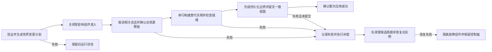

# 生命周期与配置事务

[方案入口](README.md) · [通道与执行契约](contracts.md) · [Rust 详细签名](rust-contracts.md)

本文件保存完整资源所有权、容量/空闲、单实例替换、停止及事务状态机；已确认退出是启动同资源替代实例或恢复旧实例的前提。

<!-- source-section: 10 -->
# 生命周期配置事务与所有权

## 资源所有权

| 资源 | 管理者 | 存续条件 |
| --- | --- | --- |
| 当前已提交配置身份 | RuntimeHost | 下次整次应用成功；失败期间另记实际故障与影响范围 |
| 路由规则及不可变配置 | 当前运行组件及有界的在途求值 | 会话完成选路后不保留整份旧配置或旧代际 |
| 协议连接池和共享端点 | 单一组件实例 | 未变化则复用；替换前关闭并确认释放，不保留退役池等待自然结束 |
| 独立业务流 | 会话执行范围 | 资源未受重建影响则继续；重建、撤权或截止时取消 |
| 接收器和可变解码状态 | 单一协议会话 | 会话关闭 |
| 系统接口、路由与宿主借入资源 | 平台资源所有者 | 按拥有关系恢复或释放 |
| 后台任务 | 所属组件 TaskScope | 登记、监督、取消并等待退出；替代实例启动前确认旧任务退出 |

Arc 只用于真实共享，不能让旧句柄保活退役组件、连接池或整份配置。普通规则、组选择更新保留已有连接；需要重建共享资源时，允许终止依赖该资源的连接，其他连接保留。明确禁用凭证或撤销接入权限时，内核按认证身份拒绝新连接并终止相关会话；限速更新作用于已有连接的后续流量，不重新选路或握手。每种操作与现有外部行为的差异均需兼容基线和账本核对。

## 容量回收与空闲语义

容量不足时优先保留已有业务，拒绝新增连接或会话并报告容量不足；拒绝本身也受握手及准入预算约束，不先启动无限任务再检查上限。正常超时、明确撤权、资源重建和不可恢复传输故障仍按各自契约关闭连接。容量压力不得临时缩短既有空闲超时，也不得以创建时间或低流量为理由选择活跃业务作为牺牲者。

| 状态 | 判定依据 | 容量压力下的处理 |
| --- | --- | --- |
| 建立较久的连接 | 创建时间只表示年龄，不能证明无业务 | 不按年龄踢连接；协议明确的密钥寿命或最大连接寿命另按原契约执行 |
| 暂时无流量的业务 | 仍有业务所有者或未结束逻辑会话 | 不当作空闲池条目；只有明确配置的业务或传输超时可以使其结束 |
| 可回收池资源 | 没有借用者、活跃子会话、在途建连或未完成的发送和交付，且所属组件确认可释放 | 按池上限或空闲时间回收；需要 LRU 时，仅在这个集合内选择 |
| UDP 关联 | 由对应关联的有效收发活动和配置的空闲截止时间判定 | 按原有关联超时结束，不能仅因一段采样无流量或全局 LRU 提前淘汰 |
| 防重放与安全状态 | 协议规定的有效窗口及关联生命周期 | 有效期内不得为容量淘汰；只能按协议允许的条件过期，满时拒绝新增 |

业务空闲、连接池空闲、协议原生传输超时、安全状态保留期分别定义。业务活动与心跳、保活的作用域不同；保持现有配置项的活动口径、默认值和超时含义，不把 carrier 存活自动解释为业务活跃，也不把协议传输超时偷换成无业务池回收。双向中任一方向的有效活动必须按对应契约刷新活动；半关闭、等待响应、限速或背压等待不能仅凭最近采样无字节就判成可回收。超时发生时仍按显式超时策略处理，不因存在等待而永久保活。现有 TCP 已按成功的非零读写刷新活动，迁移需保留其行为。[TCP 活动计时](../../crates/proxy/src/runtime/tcp_ingress/contract/activity.rs#L64)、[长时间活跃连接测试](../../crates/proxy/src/runtime/tcp_ingress/runtime/tests.rs#L9)。

回收资格由资源所有者依据现有租借、子会话和待处理状态判断，不仅看 last_used、Arc 引用计数或定时器。检查、标记关闭和阻止新借用在同一受保护的状态变更中完成，避免回收与重新使用竞争；状态不确定时拒绝新需求而不猜测可释放。UDP 关联结束后的迟到响应不得误投到新关联。Shadowsocks 当前对仍有效的防重放条目已有容量拒绝规则，该语义必须保留。[防重放状态容量](../../protocols/shadowsocks/src/udp/inbound/state.rs#L35)。

这些条件由各资源所有者的小范围状态和现有有界容器执行，不新增全局 LRU、统一扫描调度器或复杂资源管理框架。内部结束原因区分容量拒绝、业务超时、传输超时、撤权和组件重建，再按现有 API 的稳定语义投影。

## 配置事务

事务由 RuntimeHost 串行协调，所有 CLI、HTTP、IPC、gRPC 和适用的嵌入入口通过同一命令服务进入。持久与临时配置分别表达，不能因宿主重启把临时 overlay 写成部署配置。

低资源部署采用单实例替换：准备阶段不启动候选资源，也不要求新旧完整内核并存；对同一组件、连接池、监听器或设备，不同时运行新旧实例。宿主计算包含依赖影响的重建集合，关闭其准入、取消必要会话并等待旧任务和 I/O 释放，再按依赖顺序串行构建替代资源；整次成功前不开放候选业务准入。未变化组件复用且继续服务。新端口不在旧实例运行时提前持有备用监听，端口冲突可能在切换阶段才暴露，按失败恢复流程处理。

磁盘文件、系统网络和内存引用不具备天然的全局原子性。事务需有明确的应用阶段和恢复记录，记录旧配置身份、候选身份及已完成副作用。持久化策略在保持既有 wire 语义的前提下实现，不能用一个原子指针交换掩盖持久化失败。

成功确认须达到现有命令要求的运行就绪和必要持久化边界，并提交整份配置；不允许部分成功。资源重建前必须确认旧资源已退出，不采用发布后长期排空旧池或旧设备。已有独立连接仅在未依赖被重建资源时继续。失败时先关闭已构建候选，再依补偿记录恢复受影响旧配置的实例；不依靠双份运行实例回滚，已断连接无法恢复。

只有恢复得到确认，才能宣称旧状态已恢复。若恢复旧资源也失败，隔离受影响组件并停止其新接入，保留确认正常的业务与控制面，报告具体故障并允许后续修复应用；不以正常旧状态掩盖混合或缺失资源，不自动退出整个内核。失败候选不能提交为新版本，最后成功版本与当前健康状态分别表达。外部错误、revision、config.changed、成功及无变化分类按既有命令语义映射；必要差异登记兼容性账本。

## 停止

主动停止整个内核时，先原子关闭新业务准入，立即向握手、已有业务会话和协议后台任务发出取消，不等待业务自然结束。随后按依赖顺序关闭组件、连接池、监听器和拥有的设备，等待任务与底层 I/O 退出，完成由内核拥有的系统路由及 DNS 恢复，再完成必要的本地状态、结算事实和可靠投递义务的持久化收尾，确认后才正常退出进程。外部接收方暂时不可达不要求无限等待远端 ACK；已承诺可靠的事实按既有 outbox 及恢复契约保存。宿主借入资源保持原拥有关系，不因停止误关外部资源。

显式 shutdown().await 返回已核对的收尾结果；发出取消、调用 abort 或丢弃 JoinHandle 均不等于确认任务退出，Drop 仅作兜底。公共组件 TaskScope 登记、监督、取消并等待后台任务，业务任务归会话范围；任务关闭仍需要其所属 I/O 和资源所有者确认释放。清理超时或失败须明确报告未完成事项和实际状态，不能提前返回停止成功或把超时等价于已释放；不默认用强制进程退出来掩盖清理失败。具体阶段时限及故障恢复状态表在契约细化时冻结。统一采用 Tokio，TaskScope 保持轻量，不增加多层执行包装；组件替换仍须确认旧实例退出后才启动替代实例。[Tokio JoinSet](https://docs.rs/tokio/latest/tokio/task/struct.JoinSet.html)。

## 身份代际与可变策略

| 身份或状态 | 存续规则 | 变更行为 |
| --- | --- | --- |
| ComponentId | 标识一份配置组件或共享资源所有者 | 同一配置位置保持身份，替换时增加 ResourceGeneration |
| RoleId | 指向某 ComponentId 提供的一项实际角色 | 入站、出站、Packet 角色可以共用一个资源生命周期 |
| ConfigRevision | 整次成功提交的配置身份 | 不用它直接判定所有池都必须重建 |
| ResourceGeneration | 单资源及依赖的运行身份 | 静态配置、信任或相关依赖改变才替换；旧角色不可重新获取业务 |
| NetworkGeneration | 物理出口及硬拨号环境身份 | 只失效依赖该出口的载体，不使无关池全部清空 |
| AuthSubject 与 PolicyRevision | 协议认证后交付的中立主体及当前策略 | 内核统一处理撤权、限速、设备和已有配额语义，不引入面板用户模型 |
| SessionId 与协议逻辑关联 | 一次业务及协议自己的子流/UDP 会话身份 | 不仅凭目标地址合并；跨目标、用户及客户端会话保持隔离 |

复用判定包含协议拥有的静态 Options 身份、共享资源归属及相关依赖身份；不能只看 tag，也不能每次全局修订都重建。池键的私有部分由协议产生，公共部分加入上游前缀、网络和策略所需隔离维度，不从通用运行层读取秘密构造字符串。旧句柄关闭后仅保留诊断所需轻量身份，不允许它保活退役池、后台驱动或大缓冲。

建立新通道前，内核在同一准入步骤中检查角色代际和撤销状态，防止“选路时有效、拨号时已关闭”的竞争。已有流无需为普通规则更新重新选路。限速通过当前策略状态作用于后续流量；明确撤权按认证主体取消存量。匿名业务采用独立会话策略，不要求外部账户。协议私有认证数据的静态轮换若必须重建共享资源，应走已声明的重建影响范围，不能伪装成无影响热修改。

## 就绪不等于所有远端可达

| 组件 | Ready 的必要条件 | 不要求的默认预热 |
| --- | --- | --- |
| 普通入站 | 声明的本地监听和必需驱动已就绪，业务准入门受宿主控制 | 不提前建立业务会话或填满接收队列 |
| 普通出站 | Options 和实际能力已构建，所需本地设施可调用 | 不连接每个远端、不预建完整池；远端拨号和认证在首次需求发生 |
| QUIC/MUX 池 | 管理对象和有界状态就绪 | 不为每个标签、上游前缀和目标提前启动连接 |
| Packet Endpoint/TUN | 本地设备及 I/O 所有者就绪，必要平台状态可确认 | 不把远端 peer 暂未握手等同于本地设备不存在 |
| 控制源或反向隧道 | 按声明的 Ready 条件完成本地源准备；若必须连通控制端，使用显式截止时间 | 不用无限后台重试掩盖启动失败 |
| DNS | 已验证服务、查询路由和必要状态可用 | 不为每个域名预查，不要求所有上游同时网络可达 |

远端健康、认证结果与本地组件 Ready 分开记录。声明为启动必需的控制载体由限定 opener 提供，不能为它伪造业务 SessionId 或给协议一个全局直连出口。一次性标准健康探测可走现有诊断入口，不能成为每次配置应用暗中创建第二套池的理由。

## 生命周期与配置应用状态表

RuntimeHost 只串行执行一个应用事务。RequestTimeout 表示调用方停止等待，不自动等于事务失败或已回滚；事务由受监督的宿主任务继续完成或补偿，调用者不能通过丢弃 Future 把系统留在半切换状态。主动停止内核会在提交前安全取消事务并收尾，提交后按当前已提交状态执行停止。

| 组件状态 | 可进行的操作 | 退出条件 |
| --- | --- | --- |
| Planned | 纯配置、差异和依赖检查 | 尚无第二套运行资源；旧实例可继续服务 |
| Quiescing | 撤销受影响角色准入，取消相关业务 | 新调用看到 Revoked；共享资源的所有受影响角色一并处理 |
| Closing | 等待旧任务、I/O 和设备释放 | CloseReport 无未完成项，才允许替代资源构建 |
| Building | 按依赖顺序串行构建替代实例 | 先保存生命周期所有者，再启动资源；失败仍有明确关闭对象 |
| Ready | 驱动就绪，候选业务门仍关闭 | 全部受影响组件 Ready，满足持久化边界 |
| Active | 当前提交角色可被新业务取得 | 配置变更、撤权、故障或主动停止 |
| Faulted | 隔离受影响角色，控制面可诊断修复 | 明确补偿完成或后续修复事务成功；不假冒 Active |
| Closed | 已确认任务及自有 I/O 退出 | 终态；旧句柄调用返回 Closed/Revoked，不能重新激活 |

配置修订只在整次提交时前进。一个事务内部可以依次构建多个不同组件，但同一资源所有者不允许新旧运行实例重叠；不预热第二套完整内核。已停旧组件可能造成局部断流，恢复旧配置也不能还原已断连接。其他未变化的健康组件继续服务，不能把暂态组合发布为部分成功的配置。

| 应用阶段 | 执行动作 | 失败处理 |
| --- | --- | --- |
| Validate | 解码、协议校验、引用和能力验证 | 旧状态保持，失败不提交修订 |
| Plan | 计算受影响依赖闭包、资源身份与补偿步骤；按预算检查文件 | 不构建候选池、socket、设备或后台驱动 |
| StopOld | 关闭受影响准入，取消并确认旧资源退出 | 不启动替代实例；记录实际影响并恢复能确认安全的旧状态 |
| BuildNew | 按依赖顺序串行构建、启动并检查就绪 | 先关闭所有已构建候选，确认释放后再恢复旧实例 |
| Persist | 对持久命令完成既有持久化承诺；临时 overlay 不写部署配置 | 提交前失败执行补偿；磁盘结果不确定时核对实际文件和恢复记录，不能盲称回滚 |
| Commit | 发布一致的配置、策略及角色视图，推进一次修订并开放准入 | 设计为受锁保护的内存提交，不在提交点执行网络 I/O |
| Acknowledge | 对外返回真实应用结果 | 返回链路丢失或等待超时不撤销已提交配置，按实例身份与修订重新查询 |
| Compensate | 候选关闭确认后，按旧配置及依赖恢复受影响实例 | 再次失败进入 Faulted，保留健康业务和控制面，不提交失败候选 |

持久化不假设文件、内存和系统网络天然原子。使用现有原子文件替换与一份最小的事务恢复记录，记录尝试身份、旧及候选摘要、持久/临时模式、已完成阶段和资源补偿身份；不为此增加数据库或通用工作流框架。持久候选在运行资源 Ready 前不得覆盖唯一的上次有效部署配置；旧配置备份与记录权限和配置文件一致，日志不输出凭证。

崩溃发生在持久提交前，重新启动按上次持久配置恢复；发生在候选已经持久提交而应用响应尚未送达时，启动按恢复记录核对的持久配置恢复，使用新的 core_instance_id，不能声称旧调用已收到成功响应。临时 overlay 不在重启后自动变成持久配置。恢复记录不证明端口仍可绑定；重建失败仍如实进入故障状态。

停止和补偿的各阶段共享调用的单调 deadline，并记录完成进度。等待超时不能把未退出资源标记 Closed，也不能在它旁边启动替代实例；后台恢复若继续，必须是有界、受监督且可查询的任务。既有 V1 方法没有操作票据的，使用其现有错误、状态与修订查询组合表达，不因内部 AttemptId 自动增加外部必填字段。

## 提交边界与故障语义

调用者使用 expected_current 或既有等价前置条件时，冲突在任何运行副作用前拒绝。无变化配置复用全部资源，并保留原来的无变化分类。提交后发生的驱动故障属于当前运行故障，不因控制响应超时自动重放上一次事务；重复请求先比较当前配置身份和修订，避免同一配置被反复停旧重建。

候选清理失败时不得马上恢复同一资源的旧实例；否则仍违反无双实例。控制面显示最后成功配置身份和实际缺失/故障资源，两者分开，不能用旧 revision 掩盖运行状态。回滚范围包括 DNS、监听、设备、应用服务和当前事务改变的自有平台状态；失败前根本没有触及的组件不重启。

主动停止采用已确定的立即取消业务策略：先停新准入，取消握手、会话与组件任务；确认任务和 I/O 退出、设备关闭、自有路由/DNS 恢复以及必要本地可靠状态收尾后正常退出。控制面和停止监督最后收尾；不把等待远端 Webhook ACK 作为无期限退出条件，也不把取消发出、Drop 或 abort 当作退出确认。
<!-- /source-section: 10 -->
